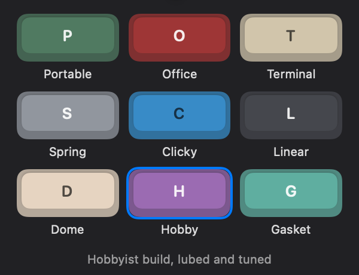

# Keycadence

Mechanical keyboard sounds for your Mac, with as little delay as possible between pressing
a key and hearing it. A native menu bar app, free and open source.



- **Nine real keyboards.** Every sound is cut from a real recording, from a manual
  typewriter and a 1970s electric to buckling springs and a modern gasket-mount board.
- **Sounds like a keyboard in front of you.** Keys sit left to right as they do on your
  keyboard, with natural variation and a tone control. Also has spatial sound on headphones,
  mouse clicks and a bell on Return.
- **Goes quiet when you need it.** Lower or mute the sound during calendar events, when the
  mic or camera is on, and more.
- **Private.** It's sandboxed and has no network access, so it can't send anything anywhere.
  See the [privacy policy](docs/privacy.md).

## Install

Needs Apple silicon and macOS 14.2 or later. So far it has only been tested on macOS 27, so
please open an issue if something's off on an older version.

```bash
brew install --cask jdbrewer/tap/keycadence
```

Or download the zip from [Releases](https://github.com/jdbrewer/keycadence/releases) and move
the app to Applications.

On first launch, macOS asks for **Input Monitoring**, which lets the app detect key presses.
Each press only chooses a sound. Presses are never stored.

## How it's fast

The path from key to sound is C, so no Swift runtime work can run on it. SwiftUI is only the
settings UI, and it isn't built until first opened.

```
key press -> event tap (own thread) -> lock-free ring -> audio callback -> device
```

- The audio callback never locks, allocates or makes system calls.
- Sounds and engine state are wired into RAM, so playback can't hit a page fault.
- The output asks for a 128-frame buffer (2.67 ms at 48 kHz).
- The output stops after 20 s without keys, because a running CoreAudio output blocks system
  idle sleep and costs power. The output unit stays built, so the next key restarts it
  within milliseconds.

Measured on one M3 Max with built-in speakers at 48 kHz:

| | |
| --- | --- |
| Key press to sound, by microphone | about 24 ms |
| Of that, reported by the speakers themselves | 17.4 ms |
| Key event to first sample, output running | about 5.5 ms |
| Key event to first sample, first key after idle | 9 to 18 ms |
| CPU while typing / idle | about 0.6% / under 0.01% of one core |

The microphone figure comes from one run of 120 presses, and subtracts an estimate of the
mic's own delay. The test presses keys in software, so a physical keyboard's delay comes on
top. Bluetooth headphones add much more.

### Measure it yourself

The silent benchmark times the engine, at volume 0:

```bash
cd Engine && swift run -c release kc-bench latency ../App/Resources/sounds.kcpack
```

The acoustic test uses the microphone to time a running key-sound app, from outside the app.
Quit any other key-sound app first. It needs Microphone and Accessibility access for your
terminal. Absolute numbers include the mic's own delay, so they're best for comparing setups:

```bash
cd Engine && swift run -c release kc-bench acoustic Keycadence
```

## Building

Needs Xcode and [XcodeGen](https://github.com/yonaskolb/XcodeGen). `Keycadence.xcodeproj` is
generated from `project.yml`. To build it yourself, change `DEVELOPMENT_TEAM` and the bundle
ID in `project.yml` to your own.

```bash
tools/build.sh Release
```

```bash
cd Engine && DEVELOPER_DIR=/Applications/Xcode.app/Contents/Developer swift test
```

| Path | What |
| --- | --- |
| `Engine/Sources/CKeycadence` | Real-time engine: mixer, output, key tap |
| `Engine/Sources/kc-bench` | Latency tests and offline renderer |
| `Engine/Tests` | Engine tests |
| `App` | Menu bar app, settings and quiet rules |
| `tools/build_pack.py` | Cuts recordings into `App/Resources/sounds.kcpack` |
| `tools/release.sh` | Signed, notarized release ([docs/RELEASING.md](docs/RELEASING.md)) |
| `tools/snapshots.sh` | Renders every screen to PNGs from a Debug build |
| `packaging/homebrew` | Homebrew cask |

## Sounds

Every sound comes from a recording released under CC0. See [docs/CREDITS.md](docs/CREDITS.md)
for each source. The raw recordings stay out of git because of their size. To rebuild the pack,
which needs Python with numpy and ffmpeg, download them into `sources/raw/` and run
`tools/build_pack.py`. To listen to a switch:

```bash
cd Engine && swift run -c release kc-bench render ../App/Resources/sounds.kcpack /tmp/typing.wav 8
```

## License

[MIT](LICENSE). Product names in the credits identify the source recordings only, and
Keycadence isn't affiliated with those companies.
